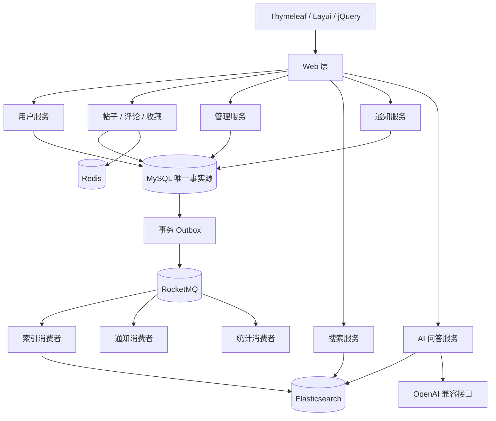

# BBS 社区论坛系统需求设计

- 文档状态：已完成设计评审，待用户复核书面规格
- 日期：2026-08-11
- 项目定位：简历/面试展示型后端项目
- 核心目标：亮点完整、链路可演示、代码质量适中

## 1. 项目目标

BBS 是一个基于 Spring Boot、MyBatis-Plus、MySQL、Redis、Thymeleaf、Layui 和 jQuery 的社区论坛。系统为普通用户提供注册登录、发帖、评论、收藏、搜索、站内通知和社区 AI 问答，为管理员提供内容治理、用户状态、分类和基础运营统计。

项目必须完整演示以下技术链路：

1. MySQL 保存论坛业务事实。
2. Redis 提供帖子详情缓存、访问去重、限流和 24 小时热榜。
3. 业务事务在 MySQL 中同时写入 Outbox 事件。
4. Outbox 发布器通过 RocketMQ 异步驱动索引、通知和统计。
5. Elasticsearch 提供中文全文检索、过滤、排序和高亮。
6. RAG 从 Elasticsearch 检索社区帖子，调用 OpenAI 兼容模型生成带来源引用的回答。
7. 管理员隐藏内容后，该内容最终从缓存、搜索和 RAG 中移除。

## 2. 范围

### 2.1 第一版包含

- 普通用户和管理员两种账号角色。
- 注册、登录、退出、验证码、资料、头像和密码管理。
- 帖子分类、发布、浏览、编辑、逻辑删除和内容治理。
- 评论、回复、删除和分页展示。
- 收藏、取消收藏和收藏列表。
- 评论、回复和收藏触发的站内通知。
- Redis 详情缓存、访问去重、限流和热榜。
- Elasticsearch 全文搜索和关键词高亮。
- RocketMQ 异步索引、通知和统计。
- 基于 ES BM25 检索的社区 RAG 问答。
- 管理员内容治理、用户状态、分类和基础统计页面。
- Docker Compose 演示环境和核心链路自动化测试。

### 2.2 第一版不包含

- 微服务拆分、API 网关和服务注册中心。
- 私信、实时聊天、关注和粉丝系统。
- 邮件、短信、支付和商业化功能。
- 对象存储、CDN 和复杂推荐系统。
- 向量数据库和 Embedding 检索。
- 版主、多级管理员和复杂权限配置。
- 举报工单和完整管理员审计平台。

## 3. 角色与权限

### 3.1 访客

- 可以注册、登录和获取验证码。
- 可以浏览公开帖子、评论、分类、热榜和用户公开主页。
- 可以使用关键词、分类、时间和排序条件搜索公开帖子。
- 不能发帖、评论、收藏、使用 AI 问答或访问个人中心。

### 3.2 普通用户

- 拥有访客的全部只读能力。
- 可以发布帖子，编辑或删除自己的帖子。
- 可以评论帖子、回复评论，删除自己的评论。
- 可以收藏或取消收藏帖子并查看收藏列表。
- 可以查看通知、未读数，执行单条已读和全部已读。
- 可以使用社区 AI 问答。
- 可以维护昵称、简介、位置、性别、头像和密码。

### 3.3 管理员

- 拥有普通用户能力。
- 可以隐藏、恢复或删除帖子和评论。
- 可以禁用或恢复用户账号。
- 可以新增、编辑、排序和停用分类。
- 可以查看用户、帖子和评论总量、每日新增趋势和 24 小时热帖。
- 隐藏内容时必须填写原因，系统记录管理员、目标、动作、原因和时间。

### 3.4 权限通用规则

- 所有写操作必须登录。
- 普通用户写操作必须校验资源归属，不能信任请求中的用户 ID。
- 当前用户 ID 只能从 Session/SecurityContext 获取。
- 禁用用户不能登录或执行写操作，历史公开内容默认保留。
- 用户被禁用后，已有 Session 在下一次鉴权时立即失效。
- 管理员接口必须验证 `ADMIN` 角色。

## 4. 内容状态

帖子和评论使用以下状态：

- `NORMAL`：公开可见，可进入缓存、搜索、热榜和 RAG。
- `HIDDEN`：公共页面、搜索和 RAG 不可见；作者可以看到隐藏状态和原因。
- `DELETED`：逻辑删除，普通用户不可见且不可恢复。

非作者访问 `HIDDEN` 内容时按不存在处理；作者和管理员可以通过个人中心或管理页面查看，但不能继续产生评论、收藏或浏览计数。

状态流转：

```text
NORMAL <-> HIDDEN -> DELETED
NORMAL ----------> DELETED
```

帖子和评论发布后默认进入 `NORMAL`，不进行发布前审核。管理员执行隐藏或删除后，系统必须失效缓存并发布内容变更事件。

## 5. 功能需求

### 5.1 账号

- `AUTH-01` 注册登录名必须为合法邮箱且唯一。
- `AUTH-02` 密码使用 BCrypt 保存，成本参数默认 12。
- `AUTH-03` 登录、注册和敏感写操作使用验证码或等价风控机制。
- `AUTH-04` 登录连续失败、验证码获取和 AI 问答使用 Redis 限流。
- `AUTH-05` 修改密码必须验证原密码，并使其他活动会话失效。
- `AUTH-06` 用户资料更新只接受允许修改的 DTO 字段。

### 5.2 帖子与分类

- `POST-01` 登录用户可以按启用分类发布帖子。
- `POST-02` 标题必填且不超过 32 个字符，正文必填并限制最大长度。
- `POST-03` 帖子作者可以编辑或逻辑删除自己的帖子。
- `POST-04` 帖子详情展示作者、分类、正文、时间、浏览数、评论数和收藏数。
- `POST-05` 管理员可以隐藏、恢复或删除帖子。
- `POST-06` 分类支持名称、排序和启用状态；停用分类不能用于新帖。
- `POST-07` 帖子计数不得为负数，重复消息不得重复增加计数。
- `POST-08` 浏览、评论和收藏计数使用原子 SQL 或带重试的乐观锁更新，避免并发丢失。

第一版正文最大长度为 100,000 个字符。图片上传单文件最大 10MB，每次最多 5 个文件，允许 JPEG、PNG、GIF 和 WebP。

### 5.3 评论与收藏

- `SOCIAL-01` 登录用户可以评论帖子或回复某条评论。
- `SOCIAL-02` 评论正文必填且不超过 200 个字符。
- `SOCIAL-03` 评论者可以删除自己的评论，帖子作者可以删除自己帖子下的评论。
- `SOCIAL-04` 管理员可以隐藏、恢复或删除评论。
- `SOCIAL-05` 同一用户对同一帖子最多存在一条有效收藏记录。
- `SOCIAL-06` 收藏、取消收藏和评论删除必须正确修正帖子计数。

### 5.4 站内通知

- `NOTICE-01` 评论我的帖子时通知帖子作者。
- `NOTICE-02` 回复我的评论时通知被回复用户。
- `NOTICE-03` 收藏我的帖子时通知帖子作者。
- `NOTICE-04` 自己触发的动作不通知自己。
- `NOTICE-05` 相同业务事件和接收人只能生成一条通知。
- `NOTICE-06` 支持未读数、分页列表、单条已读和全部已读。
- `NOTICE-07` 通知失败可重试，但不能阻塞评论或收藏主流程。

通知默认保留 90 天；过期通知可以由定时任务清理，不影响业务事实。

### 5.5 管理与统计

- `ADMIN-01` 管理员可以按状态、分类、作者和时间筛选帖子与评论。
- `ADMIN-02` 管理员内容治理必须记录原因和操作记录。
- `ADMIN-03` 管理员可以禁用或恢复用户。
- `ADMIN-04` 管理首页显示用户、帖子和评论总量。
- `ADMIN-05` 管理首页显示每日新增用户、帖子和评论趋势。
- `ADMIN-06` 管理首页显示滚动 24 小时热帖。

## 6. 总体架构

采用增量式分层单体。系统保持一个 Spring Boot 进程和一个 Thymeleaf Web 应用，不拆分微服务。



### 6.1 分层约束

- Web 层负责请求 DTO、校验、身份、页面渲染和统一响应。
- Web 层不得直接操作 Mapper、Redis、ES、RocketMQ 或模型 SDK。
- 应用服务负责事务边界和业务编排。
- MySQL 是唯一事实源；Redis 与 ES 必须可以从 MySQL 重建。
- Redis、ES、RocketMQ 和模型调用通过基础设施适配接口封装。
- 搜索、通知或 AI 故障不能阻止基础论坛发帖和互动。

## 7. 数据模型

### 7.1 核心表

| 表 | 用途 | 关键约束 |
| --- | --- | --- |
| `bbs_user` | 账号、角色、状态和资料 | 邮箱唯一；BCrypt 哈希 |
| `bbs_category` | 帖子分类 | 名称唯一；排序；启用状态 |
| `bbs_post` | 帖子事实和聚合计数 | 状态；逻辑删除；乐观锁版本 |
| `bbs_comment` | 评论和回复 | 帖子、评论人、父评论、状态 |
| `bbs_collect` | 用户收藏 | `(user_id, post_id)` 唯一 |
| `bbs_notification` | 站内通知 | `(event_id, recipient_id)` 唯一 |
| `event_outbox` | 可靠消息发送 | `event_id` 全局唯一 |
| `moderation_record` | 内容治理记录 | 目标、动作、原因、管理员、时间 |
| `daily_stat` | 每日新增统计 | 日期唯一 |

### 7.2 通用规则

- 用户角色：`USER / ADMIN`。
- 用户状态：`NORMAL / DISABLED`。
- Outbox 状态：`NEW / SENT / FAILED`。
- 帖子增加 `version` 字段，用于乐观锁和索引事件版本判断。
- 所有表包含创建时间和更新时间。
- 时间按 UTC 存储，按 `Asia/Shanghai` 展示。
- 数据库结构、索引和基础分类数据由 Flyway 版本化脚本管理。

## 8. Redis 与缓存一致性

### 8.1 详情缓存

- 帖子详情键：`bbs:post:detail:{postId}`。
- 使用 Cache-Aside：先读 Redis，未命中再读 MySQL 并回填。
- 正常详情 TTL 为 30 分钟加 0 至 5 分钟随机抖动。
- 不存在的帖子缓存空值 60 秒，降低缓存穿透。
- 热点缓存重建使用短时分布式锁，降低缓存击穿。
- 用户或帖子详情对象不得永久缓存。

### 8.2 写入一致性

1. 在 MySQL 事务中更新业务数据并写入 Outbox。
2. 事务提交后删除相关 Redis 缓存。
3. Outbox 发布器发送内容变更事件。
4. 缓存删除失败由异步事件再次删除并记录重试。

业务代码不直接使用旧实体覆盖整份帖子缓存。所有删除和补偿操作必须幂等。

### 8.3 浏览去重

- 登录用户使用用户 ID，访客使用脱敏后的 IP 与 User-Agent 指纹。
- 同一主体对同一帖子 24 小时内只增加一次浏览计数。
- 指纹仅用于短期去重，不保存原始 IP 和 User-Agent。

## 9. 24 小时热榜

候选帖子为过去 24 小时发生过浏览、评论或收藏且状态为 `NORMAL` 的帖子。

```text
基础得分 = log10(浏览数 + 1) * 1 + 评论数 * 3 + 收藏数 * 5
热度 = 基础得分 * exp(-距最后互动小时数 / 12)
```

- Redis ZSET 键为 `bbs:hot:24h`，成员为帖子 ID，score 为热度。
- 浏览、评论、收藏和反向操作通过事件增量更新热度。
- 隐藏或删除帖子必须立即从热榜移除。
- 系统提供热榜重建任务，可以根据 MySQL 和近期事件重新生成 ZSET。
- 首页默认展示前 10 条公开热帖。

## 10. RocketMQ 与最终一致性

### 10.1 Outbox

- 业务变更与 Outbox 事件在同一个 MySQL 事务中提交。
- 事件包含 `eventId`、`aggregateType`、`aggregateId`、`version`、`eventType`、`payload` 和时间。
- 发布器扫描 `NEW/FAILED` 事件，成功发送后标记 `SENT`。
- 发送失败采用有限次数指数退避，保留失败原因和下次重试时间。

### 10.2 消费者

- 索引消费者处理帖子创建、更新、隐藏和删除。
- 通知消费者处理评论、回复和收藏事件。
- 统计消费者处理用户、帖子和评论新增事件。
- 所有消费者按 `eventId` 幂等。
- 旧 `version` 事件不能覆盖 ES 中较新版本。
- 超过重试次数的消息进入死信队列并产生可观测告警。

### 10.3 修复能力

- 管理员可以按帖子 ID 重建索引。
- 管理员可以触发全量索引重建。
- 定时任务抽样比对 MySQL 与 ES，发现状态或版本差异时修复。

## 11. Elasticsearch 搜索

索引别名为 `bbs_post`，物理索引使用版本名，例如 `bbs_post_v1`，方便无停机重建和切换。

### 11.1 文档字段

- 检索字段：`title`、`contentText`。
- 过滤字段：`postId`、`categoryId`、`status`、`createTime`、`updateTime`。
- 排序字段：`views`、`comments`、`collects`、`hotScore`、`createTime`。
- 辅助展示字段：作者 ID、作者昵称、分类名称和摘要。

### 11.2 检索规则

- 中文索引分词使用 `ik_max_word`，查询分词使用 `ik_smart`。
- 标题权重高于正文。
- 只索引 `NORMAL` 帖子。
- 支持关键词、分类和时间范围组合筛选。
- 支持相关度、热度和发布时间排序。
- 标题和正文返回高亮片段。
- ES 不可用时返回搜索暂不可用，不回退到低质量 SQL 模糊查询。

## 12. RAG 社区问答

### 12.1 流程

1. 验证登录状态、问题长度和用户限流。
2. 清理输入并使用 ES 检索 `NORMAL` 帖子。
3. 选取满足最低相关度的 Top 5 帖子。
4. 提取标题、链接和正文纯文本片段，限制上下文总长度。
5. 构建严格 Prompt，要求模型只依据社区上下文回答。
6. 通过可配置的 OpenAI 兼容接口调用模型。
7. 返回回答以及引用帖子的 ID、标题、链接和相关片段。

### 12.2 回答规则

- 第一版使用 ES BM25，不使用向量数据库或 Embedding。
- 帖子正文被视为资料，不能作为覆盖系统 Prompt 的指令。
- 模型使用低温度参数，减少自由发挥。
- 无命中、相关度不足或资料冲突时返回“社区暂无足够可靠资料”。
- 模型不可用时不生成答案，但可以返回检索到的相关帖子。
- 记录问题摘要、检索帖子 ID、耗时、模型和结果状态。
- API Key、Token 和完整敏感 Prompt 不进入代码或日志。

## 13. Web 与接口边界

### 13.1 Thymeleaf 页面

- `GET /`：首页、分类和热帖。
- `GET /posts/{id}`：帖子详情和评论分页。
- `GET /search`：搜索页面和结果。
- `GET /users/{id}`：用户公开主页。
- `GET /me/**`：个人中心、帖子、评论、收藏、设置和通知。
- `GET /admin/**`：管理员页面。
- `GET /ai`：社区智能问答页。

### 13.2 JSON API

写操作统一位于 `/api/v1`：

- `/api/v1/auth`：注册、登录和退出。
- `/api/v1/posts`：新增、编辑和删除帖子。
- `/api/v1/posts/{id}/comments`：评论、回复和删除。
- `/api/v1/posts/{id}/collect`：收藏和取消收藏。
- `/api/v1/notifications`：已读操作和未读数。
- `/api/v1/ai/questions`：RAG 问答。
- `/api/v1/files/images`：头像和帖子图片上传。
- `/api/v1/admin/**`：内容治理、用户、分类和统计操作。

### 13.3 API 规则

- 请求使用专用 DTO 和 Bean Validation，不直接绑定数据库实体。
- 响应使用 `ApiResult<T>`：`code`、`message`、`traceId` 和 `data`。
- 分页响应使用统一的 `PageResult<T>`。
- 资源 ID 放路径，筛选与分页放查询参数。
- 业务校验失败返回稳定业务错误码，不暴露堆栈。
- 列表默认每页 10 条，客户端最大请求 50 条；页码从 1 开始。

## 14. 安全要求

- 使用 Spring Security、Session 和角色授权。
- 密码使用 BCrypt，数据库密码字段至少 `VARCHAR(100)`。
- 表单和 AJAX 写请求启用 CSRF Token。
- 登录、验证码和 AI 问答使用 Redis 限流。
- 同一账号或来源 10 分钟内连续登录失败 5 次后暂停登录 15 分钟。
- 单个登录用户每 10 分钟最多发起 10 次 AI 问答。
- 富文本按允许标签和属性白名单清理，普通输出默认转义。
- 搜索高亮只接受配置好的 ES 高亮标签。
- 上传限制 10MB，同时校验扩展名、MIME 和文件头。
- 上传文件随机命名并存储在不可执行目录。
- 数据库、Redis、ES、MQ 和模型密钥来自环境变量。
- 日志不得记录明文密码、密码哈希、Session ID、Token 或 API Key。

## 15. 错误处理与降级

| 故障 | 系统行为 |
| --- | --- |
| Redis 不可用 | 详情回源 MySQL；热榜、浏览去重和限流临时不可用；核心写操作继续 |
| RocketMQ 不可用 | 事件停留在 Outbox；核心写操作继续；恢复后补发 |
| Elasticsearch 不可用 | 搜索与 RAG 暂不可用；浏览、发帖和互动继续 |
| 模型接口不可用 | 不生成回答；返回相关帖子；基础论坛和搜索继续 |
| MySQL 不可用 | 核心业务不可用，返回统一错误页或 API 错误 |

- 页面请求使用统一错误页，异步请求返回统一错误结构。
- 所有错误响应和日志包含 `traceId`。
- 网络、超时和临时基础设施错误允许有限次数重试。
- 业务校验、权限拒绝和参数错误不得自动重试。
- 模型调用设置连接、读取和总超时，并在连续失败时短时熔断。

## 16. Docker Compose 与配置

Compose 环境至少包含：

- MySQL
- Redis
- Elasticsearch 与 IK 插件
- RocketMQ NameServer 和 Broker
- BBS Spring Boot 应用

要求：

- `docker compose up -d` 后无需手工建表或创建 ES 索引。
- 所有镜像版本固定并记录兼容关系。
- 基础设施配置健康检查和持久化卷。
- 仓库提供 `.env.example`，真实密钥不提交。
- Spring Boot Actuator 提供应用和依赖健康状态。

## 17. 测试要求

### 17.1 单元测试

- 热度算法和时间衰减。
- 权限和内容状态规则。
- DTO 验证和错误码。
- Prompt 构建、上下文裁剪和拒答规则。

### 17.2 Web 测试

- 注册、登录、退出和 CSRF。
- 未登录写操作拒绝。
- 资源归属与管理员授权。
- 统一响应和全局异常处理。

### 17.3 集成测试

- Redis 命中、回源、TTL、空值和缓存失效。
- MySQL 事务与 Outbox 原子性。
- RocketMQ 重复消息幂等性。
- ES 中文搜索、过滤、排序和高亮。
- 帖子隐藏后索引删除。
- RAG 使用 Mock 模型服务验证检索、Prompt、引用和拒答。

集成测试使用容器化 MySQL、Redis、ES 和 RocketMQ，不依赖开发者本机数据。

### 17.4 端到端验收

自动化覆盖以下演示链路：

```text
注册登录
-> 发布帖子
-> Redis 详情缓存
-> RocketMQ 异步索引
-> ES 搜索与高亮
-> 评论及站内通知
-> 热榜变化
-> RAG 带引用回答
-> 管理员隐藏帖子
-> 帖子从搜索和 RAG 中移除
```

## 18. 性能与时效目标

- 支持约 100 个并发用户的演示压测。
- 普通接口 P95 小于 500ms。
- 搜索接口 P95 小于 1.5s。
- 正常情况下索引、通知和热榜在 5 秒内收敛。
- AI 问答通常在 10 秒内完成。
- 重复消息不得产生重复通知、重复统计或索引版本回退。

性能目标在固定演示硬件和固定测试数据规模下测量，并在测试报告中记录环境。

## 19. 完成定义

项目满足以下条件才可以称为需求完成：

1. Docker Compose 可以在干净环境启动全部必要服务。
2. Flyway 可以从空数据库创建完整结构和基础数据。
3. 核心端到端验收链路自动化通过。
4. Redis、ES、MQ 和模型单独故障时符合降级要求。
5. MySQL、Outbox、RocketMQ 和 ES 的最终一致性场景通过测试。
6. 隐藏或删除内容不会出现在公共页面、热榜、搜索或 RAG 引用中。
7. 所有用户写操作和管理员操作通过身份、角色和资源归属校验。
8. 性能测试达到第 18 节目标。
9. 配置、密钥、数据库脚本和启动说明完整，仓库不包含真实凭据。

## 20. 实施切片

该需求是项目总规格，不应作为一次大提交实现。后续实施计划按以下可独立验收的切片展开：

1. 基线修复：恢复编译、Flyway 建库、统一 DTO/响应、Spring Security 和 BCrypt。
2. 核心论坛：账号、帖子、评论、收藏、分类、个人中心和管理员基础能力。
3. Redis 能力：详情缓存、失效补偿、访问去重、限流和 24 小时热榜。
4. 可靠异步：Outbox、RocketMQ、幂等框架、站内通知和每日统计。
5. 搜索能力：ES 索引、中文分词、同步消费者、过滤排序、高亮和重建工具。
6. RAG 问答：检索、上下文裁剪、Prompt、模型适配、引用和拒答。
7. 工程验收：Docker Compose、故障降级、端到端测试、性能测试和演示文档。

每个切片必须在进入下一切片前通过其自动化测试和演示验收，避免多个基础设施问题同时叠加。
