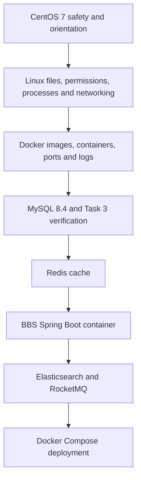

# Linux and Docker Learning Through BBS Deployment

## Status

Approved by the user on 2026-08-11.

## Context

The learner is new to Linux and Docker. The available environment is a CentOS 7 virtual machine with Docker Engine installed, while BBS development remains on Windows. The first practical milestone is the existing Task 3 Testcontainers and Flyway verification; the longer-term goal is an understandable, reproducible BBS deployment.

CentOS 7 reached end of life in 2024. It remains usable as an isolated learning VM, but the material must not present it as a recommended public production platform. Where operating-system details matter, the guide will state the CentOS 7 command and note the modern Rocky Linux 9 or Ubuntu equivalent only when useful.

## Chosen approach

Use a project-challenge learning path rather than a command encyclopedia or a one-shot full-stack deployment. Commands are introduced immediately before the BBS task that needs them, then compressed into a printable reference page.

## Audience and teaching style

- Assume no prior Linux or Docker operational experience.
- Explain what a command changes before asking the learner to run it.
- Distinguish read-only inspection commands from state-changing and destructive commands.
- Use Chinese explanations and copyable commands, but require the learner to predict or inspect the result.
- Keep each lesson focused on one observable win and request command output for feedback.

## Deliverables

### Command reference

Create a print-friendly HTML reference covering:

- Linux navigation, files, text viewing, search, permissions, users, processes, services, disk, memory, network, firewall, archives and package management.
- Docker images, containers, ports, logs, shell access, copy, resource inspection, volumes, networks, cleanup and Compose.
- Command risk labels: inspect, changes state, destructive, and requires root.
- BBS examples for MySQL, Redis, application logs and port checks.

The reference is for recall, not the main teaching sequence. Each command includes purpose, syntax, a BBS-oriented example and the most important warning.

### Learning roadmap

Create a visual roadmap that shows prerequisites, current milestone and completion evidence. The roadmap links to individual lessons and the command reference.

### Lessons

Each lesson contains:

1. A concrete goal and a small data-flow diagram.
2. The minimum required concepts.
3. Commands with parameter explanations.
4. A guided BBS exercise.
5. Observable success criteria.
6. A failure-diagnosis table ordered from cheapest check to deepest check.
7. Safe cleanup or rollback steps.
8. A short exercise whose output can be reviewed in the Codex task.
9. Links to official primary documentation.

The first new lesson inspects the CentOS 7 host and teaches the Docker container lifecycle without changing BBS code. The next lesson reuses the existing Task 3 material to run MySQL 8.4 through Testcontainers and verify Flyway version 1.

## Milestones

### Milestone 0: host safety and orientation

The learner can identify the current user, distribution, kernel, CPU, memory, disks, IP addresses, listening ports, running services and Docker version. The learner understands `sudo`, the Docker group's privilege level and why unauthenticated port 2375 must remain closed.

### Milestone 1: Linux operating basics

The learner can locate the BBS checkout, inspect files and logs, understand absolute versus relative paths, read permissions, monitor processes, control a service and diagnose a port conflict.

### Milestone 2: Docker lifecycle

The learner can pull an image, create a named container, map a port, read logs, enter a container, inspect metadata, stop, restart and remove it, and explain the difference between an image and a container.

### Milestone 3: Task 3 and MySQL persistence

The learner can run the Task 3 tests, observe the temporary MySQL container and confirm Flyway version 1 plus `BUILD SUCCESS`. A separate exercise then demonstrates why a Docker volume is required for a long-lived database.

### Milestone 4: BBS dependencies

Redis, Elasticsearch and RocketMQ are introduced one at a time. Each service must have a health check, named storage where required, a fixed internal network name and a documented host port.

### Milestone 5: application and Compose

The learner builds or runs the Spring Boot application container, supplies configuration through environment variables and connects it to services by container name. Docker Compose then records the working topology and supports start, stop, logs, health inspection and safe teardown.

## Safety model

- Never recommend `rm -rf` against broad or unresolved paths.
- Never expose Docker over unauthenticated TCP, especially `0.0.0.0:2375`.
- Do not disable SELinux or the firewall as a default fix; diagnose labels and ports first.
- Use named volumes for persistent database and search data.
- Label commands that delete containers, images, volumes or application data.
- Do not place real passwords in Git. Learning examples use clearly marked local-only credentials.
- Show cleanup commands with an explanation of exactly what survives.

## Feedback and verification

Every lesson ends with a small evidence bundle, normally three to five command outputs. The learner posts that output back to Codex. A lesson is complete only when the observable criteria are met; merely running the commands is not sufficient.

Task 3 specifically requires:

- `mysql:8.4` starts through Testcontainers.
- Flyway reports migration to version `1`.
- `FlywayMigrationTest` and `BbsApplicationTests` pass.
- Maven reports `BUILD SUCCESS` with zero failures and errors.

## Scope boundaries

This learning track does not include Kubernetes, high availability, public production hardening, automated backups, TLS certificate automation or cluster administration. Those topics follow only after the single-host Compose deployment is understood and repeatable.

## Acceptance criteria

- The reference page is readable on desktop and mobile and prints cleanly.
- Commands target CentOS 7 accurately and flag end-of-life limitations.
- Every state-changing command states its effect and recovery path.
- BBS examples are consistent with the current Phase 1 branch and do not imply that unfinished Redis, Elasticsearch, RocketMQ or RAG features are already integrated.
- The roadmap and lessons link to each other using local relative links.
- No lesson claims success without an observable command result.
